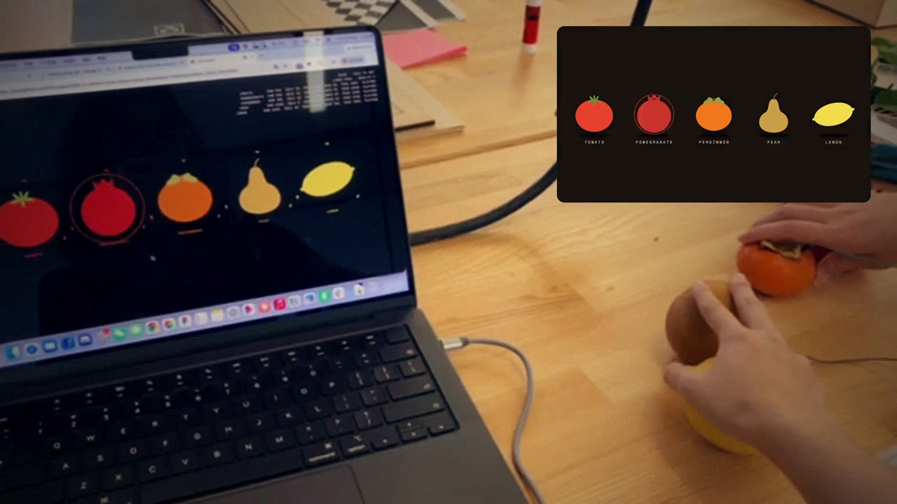
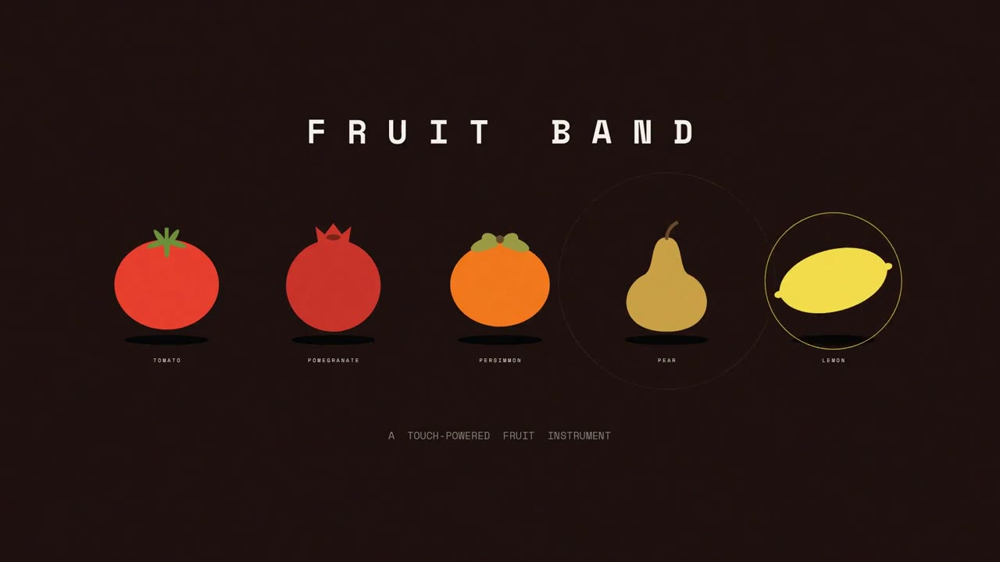

# Fruit Band

**Five real fruits become a small jazz band.** Touch a tomato and the drums start. Touch a lemon and the jazz chords come in. Touch all five and the whole band plays together.



▶ **[Watch the demo video](media/fruit_band_demo.mp4)**
▶ **[Play it in your browser](https://huanggedv.github.io/Fruit-Band/)** — no Arduino needed, just click the fruits

Made for *Technology Design Foundations — Synthesis: Invent a Musical Instrument*.

## The band

| Fruit | Part | When you squeeze or hold it |
| --- | --- | --- |
| Tomato | Drums | Drum fill |
| Pomegranate | Seed shaker | Seeds "burst" |
| Persimmon | Walking bass | Jumps up an octave |
| Pear | Melody | Sparkly high line |
| Lemon | Jazz chords | Goes sour (wobbly, out of tune) |

All five loops share one song (lo-fi jazz, D minor, 92 BPM), and each loop starts on the next beat, so any mix sounds good. All five on = **fruit salad** mode.



## How to play

**Without hardware (any browser):** open `index.html` (or the link above), click **● click to play**, cancel the port window, then:

- **Click / tap a fruit** — turn its loop on or off
- **Hold a fruit for 0.7 s** — special effect
- Keys **1–5** also work, **Shift + 1–5** = special effect

**With the fruits (Chrome or Edge):** connect the Arduino, open `index.html`, click **● click to play** and choose the Arduino's `usbmodem` port. Keep hands off the fruits for 1.5 s while it calibrates.

Hidden keys: `Space` reconnect · `C` recalibrate · `D` show sensor numbers · `T` tune

**If a fruit is hard to trigger, use tune mode:** press `T`, touch each fruit firmly 2–3 times, then press `T` again. The page measures how much each fruit really rises when touched and sets its threshold from that. It is saved in the browser, so you only need to do it again if you change fruits or wiring.

## How it works

Fruit is full of water and salts, so it conducts electricity. Each fruit is a **capacitive touch sensor**: the Arduino measures how long the fruit takes to charge through a 1 MΩ resistor. When a hand touches the fruit, the body adds capacitance, the number goes up, and the page counts it as a touch.

```
Arduino pin 2 ──[1 MΩ]──┬── pin 4 ── jumper wire into Tomato
                        ├── pin 5 ── Pomegranate
                        ├── pin 6 ── Persimmon
                        ├── pin 7 ── Pear
                        └── pin 8 ── Lemon
         (one 1 MΩ resistor per fruit, pin 2 shared, no GND wire)
```

- `arduino/fruit_band/fruit_band.ino` reads the five fruits with the **CapacitiveSensor** library and sends `tomato,pomegranate,persimmon,pear,lemon` over serial (9600 baud).
- `index.html` reads the serial data with Web Serial, plays the music live with [Tone.js](https://tonejs.github.io/), and draws the fruits on a canvas.

## Tips

- Close the Arduino Serial Monitor before opening the page. Only one program can use the port.
- Push the wire deep into the fruit, keep wires and fruits from touching each other, and keep the laptop plugged in for steadier readings.
- Each fruit gets its own threshold from its noise during calibration. If one fruit is still hard to trigger, lower its number in `SENSITIVITY` at the top of `index.html` (e.g. `0.6` → `0.4`); raise it if the fruit triggers by itself. Press `D` to see each fruit's value and the `need` value.
